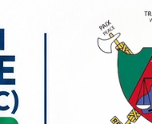

# 🎨 Charte Graphique & UI Design System
## CFPC DREAM REAL-ICT
### Centre de Formation Professionnelle et de Certification

> Ce document définit l'ensemble des règles visuelles, la palette chromatique officielle, l'anatomie du logo, la typographie et les composants d'interface utilisateur (UI) pour l'ensemble des supports digitaux, web et print de **CFPC DREAM REAL-ICT**.

---

## 📌 Sommaire
1. [Logos & Identité Visuelle](#-1-logos--identité-visuelle)
2. [Palette Chromatique Officielle](#-2-palette-chromatique-officielle)
3. [Typographie Officielle](#-3-typographie-officielle)
4. [Iconographie & Symbolique](#-4-iconographie--symbolique)
5. [Composants d'Interface UI (Web & App)](#-5-composants-dinterface-ui)
6. [Règles de Bonne Conduite & Interdictions](#-6-règles-de-bonne-conduite)

---

## 🛡️ 1. Logos & Identité Visuelle

### 1.1. Les Formats Disponibles

Le CFPC Dream Real-ICT dispose de deux déclinaisons principales de son logo :

| Format | Aperçu | Usage Recommandé | Fichier Asset |
| :--- | :---: | :--- | :--- |
| **Badge Circulaire Officiel** |  | Favicon, avatar réseaux sociaux, sceau officiel, attestations, badges élèves. | `../assets/logo_badge.png` |
| **Logo Bannière Header** |  | En-tête de site web (Navbar), documents officiels, bannières publicitaires, pied de page. | `../assets/logo_brand_header.png` |
| **Sceau Institutionnel MINEFOP** |  | Mentions légales, validation de diplôme DQP, bas de page institutionnel. | `../assets/sceau_minefop.png` |

---

### 1.2. Anatomie & Symbolique du Logo Badge

Le logo circulaire est composé de plusieurs symboles métiers forts :
1. **Le Mortarboard (Toque universitaire dorée) :** Représente l'excellence académique, la certification et l'obtention du diplôme d'État DQP validé par le MINEFOP.
2. **L'Ordinateur portable & le Graphique analytique :** Symbolise l'ère du numérique, les TIC (ICT), la gestion informatisée, la comptabilité moderne et l'intelligence artificielle.
3. **Les Trois Silhouettes d'apprenants (Vert, Bleu, Orange) :** Représentent la communauté des apprenants, l'inclusion, le travail d'équipe et la diversité des métiers formés.
4. **L'Orbite dynamique verte :** Évoque le dynamisme, la montée en compétences et la projection vers l'avenir professionnel.
5. **Le Double Cercle Bleu & Orange :** Encadre l'appellation officielle :  
   `CENTRE DE FORMATION PROFESSIONNELLE ET DE CERTIFICATION` / `CFPC DREAM REAL-ICT`.

### 1.3. La Signature & le Slogan de Marque

* **Slogan institutionnel :**  
  > *« Former aujourd'hui, bâtir demain »*
* **Slogan d'engagement étudiant :**  
  > *« Une formation, un métier, un avenir ! »*

---

## 🎨 2. Palette Chromatique Officielle

Les couleurs ont été extraites avec précision des visuels officiels et normées pour les développeurs web (HEX, RGB, HSL, CSS Variables et Tailwind CSS).

### 2.1. Couleurs Principales (Brand Colors)

```
┌─────────────────┐ ┌─────────────────┐ ┌─────────────────┐ ┌─────────────────┐
│   Bleu Nuit     │ │   Vert Émeraude │ │   Vert Vif      │ │   Jaune Solaire │
│   #083A77       │ │   #0D7C46       │ │   #43B02A       │ │   #FBA919       │
└─────────────────┘ └─────────────────┘ └─────────────────┘ └─────────────────┘
```

| Rôle Visuel | Nom de la Couleur | Code HEX | Code RGB | Tailwind Class Recommandée |
| :--- | :--- | :---: | :---: | :--- |
| **Primaire Sombre** | **Bleu Nuit Institutionnel** | `#083A77` | `rgb(8, 58, 119)` | `bg-[#083A77]`, `text-[#083A77]` |
| **Primaire Vert** | **Vert Émeraude MINEFOP** | `#0D7C46` | `rgb(13, 124, 70)` | `bg-[#0D7C46]`, `text-[#0D7C46]` |
| **Accent Vif** | **Vert Dynamique / Tech** | `#43B02A` | `rgb(67, 176, 42)` | `bg-[#43B02A]`, `text-[#43B02A]` |
| **Accent Bourses** | **Jaune Or / Solaire** | `#FBA919` | `rgb(251, 169, 25)` | `bg-[#FBA919]`, `text-[#FBA919]` |

---

### 2.2. Couleurs Métiers (Identifiants Filières)

Chaque filière dispose d'une couleur d'identification propre pour faciliter la navigation de l'étudiant :

| Filière Métier | Couleur Associée | Code HEX | Rôle dans l'UI |
| :--- | :--- | :---: | :--- |
| **Secrétariat Bureautique** | **Bleu Cyan Océan** | `#007AD7` | Badges, puces, iconographie bureautique & bureautique avancée. |
| **Secrétariat Comptable** | **Vert Pin / Comptabilité** | `#008B58` | Tableaux financiers, modules de caisse, comptabilité générale. |
| **Secrétariat de Direction** | **Violet Impérial / Direction** | `#7A1380` | Modules de management, secrétariat exécutif, accueil VIP. |
| **Offres Spéciales / Bourses** | **Or / Jaune Ambré** | `#F39200` | Pastilles « Places limitées », étoiles, bannières promos. |
| **Remise / Prix Barré** | **Rouge Alerte** | `#DC2626` | Prix barrés normaux, mentions d'urgence. |

---

### 2.3. Couleurs Neutres & Surfaces UI

| Nom | HEX | Usage |
| :--- | :---: | :--- |
| **Blanc Pur** | `#FFFFFF` | Cartes, fond d'application, textes sur fond sombre. |
| **Surface Teintée Menthe** | `#F0FDF4` | Fond des cartes « Bourses », sections de réduction. |
| **Surface Grise Neutre** | `#F8FAFC` | Fond de page général (Light mode). |
| **Bordures / Séparateurs** | `#E2E8F0` | Délimitations de cartes, séparateurs de tableaux. |
| **Texte Principal** | `#0F172A` | Titres, corps de texte haute lisibilité. |
| **Texte Secondaire** | `#64748B` | Légendes, sous-titres, dates, mentions complémentaires. |

---

### 2.4. Variables CSS Prêtes à l'Emploi

Copiez ce bloc dans votre fichier CSS global (`styles.css` ou `globals.css`) :

```css
:root {
  /* Brand Colors */
  --color-primary-navy: #083A77;
  --color-primary-navy-dark: #052650;
  --color-primary-green: #0D7C46;
  --color-primary-green-light: #43B02A;
  --color-accent-gold: #FBA919;
  --color-accent-orange: #F39200;

  /* Filières Colors */
  --color-filiere-bureautique: #007AD7;
  --color-filiere-comptable: #008B58;
  --color-filiere-direction: #7A1380;
  --color-danger-strike: #DC2626;

  /* Surfaces & Neutrals */
  --color-bg-body: #F8FAFC;
  --color-bg-card-promo: #F0FDF4;
  --color-text-main: #0F172A;
  --color-text-muted: #64748B;
  --color-border: #E2E8F0;
}
```

---

## 🔤 3. Typographie Officielle

### 3.1. Polices Recommandées

* **Titres & En-têtes (Headings) :**  
  * **Police :** `Montserrat`, `Poppins` ou `Inter` (Graisses : 700 Bold / 800 ExtraBold).
  * *Rendu :* Majuscules affirmées pour les grandes bannières d'annonces (ex: `BOURSES PARTIELLES DE FORMATION`).
* **Corps de Texte (Body Text) :**  
  * **Police :** `Inter` ou `Roboto` (Graisses : 400 Regular / 500 Medium / 600 SemiBold).
* **Slogans Manuscrit / Cursive :**  
  * **Police :** `Caveat`, `Dancing Script` ou `Great Vibes` (Graisse : 700 Bold, couleur Bleu Nuit `#083A77`).  
  * *Exemple :* `Former aujourd'hui, bâtir demain`

### 3.2. Hiérarchie Typographique

```css
h1, .hero-title {
  font-family: 'Montserrat', sans-serif;
  font-size: 2.5rem; /* 40px */
  font-weight: 800;
  text-transform: uppercase;
  color: var(--color-primary-navy);
}

h2, .section-title {
  font-family: 'Montserrat', sans-serif;
  font-size: 1.875rem; /* 30px */
  font-weight: 700;
  color: var(--color-primary-navy);
}

.slogan-script {
  font-family: 'Caveat', cursive;
  font-size: 1.75rem;
  font-weight: 700;
  color: var(--color-primary-navy);
}

p, .body-text {
  font-family: 'Inter', sans-serif;
  font-size: 1rem; /* 16px */
  line-height: 1.6;
  color: var(--color-text-main);
}
```

---

## 🧩 4. Iconographie & Symbolique

L'iconographie doit être épurée, moderne et contenue dans des pastilles circulaires colorées :

| Icône | Contexte | Couleur du Cercle |
| :---: | :--- | :---: |
| 💻 | **Bureautique & Informatique** | Bleu Cyan (`#007AD7`) |
| 🧮 | **Comptabilité & Gestion financière** | Vert Forêt (`#008B58`) |
| 👔 | **Direction & Management exécutif** | Violet (`#7A1380`) |
| 🎓 | **Diplôme DQP / MINEFOP** | Vert Émeraude (`#0D7C46`) |
| 📅 | **Calendrier / Rentrée académique** | Bleu Nuit (`#083A77`) |
| 💬 | **WhatsApp / Support direct** | Vert Dynamique (`#43B02A`) |
| 💵 | **Frais d'inscription & Tranches** | Vert d'eau / Émeraude (`#0D7C46`) |

---

## 💻 5. Composants d'Interface UI

### 5.1. Cartes de Tarifs & Bourses (Pricing Card)

```html
<!-- Exemple Composant Carte Bourse Secrétariat Bureautique -->
<div class="rounded-2xl border border-emerald-200 bg-white p-6 shadow-md transition-all hover:shadow-xl">
  <div class="flex items-center gap-4">
    <!-- Pastille Métier -->
    <div class="flex h-14 w-14 items-center justify-center rounded-full bg-[#007AD7] text-white">
      <svg class="h-7 w-7" fill="none" stroke="currentColor" viewBox="0 0 24 24">
        <!-- Icone écran -->
        <rect x="2" y="3" width="20" height="14" rx="2" stroke-width="2"/>
        <line x1="8" y1="21" x2="16" y2="21" stroke-width="2"/>
      </svg>
    </div>
    
    <!-- Intitulé -->
    <div>
      <h3 class="text-xl font-bold text-[#083A77]">Secrétariat bureautique</h3>
      <p class="text-sm font-semibold text-gray-500">
        Au lieu de <span class="text-red-500 line-through">125 000 FCFA</span>
      </p>
    </div>
  </div>

  <!-- Badge Tarif Boursier -->
  <div class="mt-6 flex items-center justify-between rounded-xl bg-[#0D7C46] px-4 py-3 text-white">
    <span class="text-sm uppercase tracking-wide">Tarif boursier</span>
    <span class="text-2xl font-black">100 000 FCFA</span>
  </div>
</div>
```

---

### 5.2. Badges & Tags UI

* **Tag Bourse Spéciale :**
  * Fond : `#FBA919` (Jaune Or)
  * Texte : `#083A77` (Bleu Nuit, Bold)
  * Arrondi : `rounded-full` ou `rounded-md`
* **Badge Diplôme DQP :**
  * Fond : `#F0FDF4`
  * Bordure : `#0D7C46`
  * Texte : `#0D7C46` (Gras)
* **Tag "Places Limitées" :**
  * Fond : `#FBA919` avec rotation légère (`transform -rotate-2`)

---

### 5.3. Boutons d'Action (Call To Action)

1. **Bouton Primaire (Inscription / Candidature) :**
   * Fond : `bg-[#0D7C46]` -> Hover : `hover:bg-[#095A32]`
   * Texte : Blanc, Bold, Majuscule.
2. **Bouton WhatsApp Contact :**
   * Fond : `bg-[#25D366]` -> Hover : `hover:bg-[#1EBE5D]`
   * Texte : Blanc, avec icône WhatsApp officielle.
3. **Bouton Secondaire / Découvrir les filières :**
   * Fond : Transparent, Bordure : `border-2 border-[#083A77]`
   * Texte : `#083A77` -> Hover : `hover:bg-[#083A77] hover:text-white`

---

## 🚫 6. Règles de Bonne Conduite & Interdictions

Pour préserver la cohérence visuelle de la marque **CFPC DREAM REAL-ICT** :
* ❌ **Ne pas déformer le ratio d'aspect du logo** (conserver impérativement les proportions 1:1 pour le badge circulaire).
* ❌ **Ne pas changer les couleurs du logo** (ne pas recolorer le logo en rouge, noir uni ou gris sans autorisation formelle).
* ❌ **Ne pas utiliser de polices fantaisistes non approuvées** pour les textes institutionnels et administratifs.
* ❌ **Toujours respecter une zone d'exclusion** minimale autour du logo égale à la hauteur du "CFPC" pour éviter l'encombrement visuel.
* ❌ **Toujours mentionner la validation officielle du MINEFOP** lors de la communication sur les diplômes DQP.

---
*Document UI/UX produit pour le projet CFPC DREAM REAL-ICT.*
